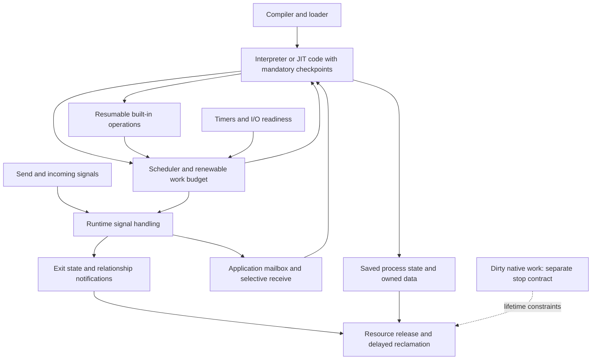

# BEAM/ERTS source map for Bream

Source review opened 2026-10-07 at the user's request. Official Erlang/OTP `OTP-29.1.1`, commit `ad05823719d77c8faee87348ea39513d4e2f99c5`, is cloned at `/home/bat/projects/bream/upstream/otp`. [Provenance](../evidence/beam-source-review/source-pin.json). The checkout is ignored by Bream's Git repository; the notes and immutable upstream citations remain independently usable. The initial source-review stage built or ran no VM. A subsequent [reference-fixture pass](research/29-pinned-reference-observations.md) now builds the pinned core and executes bounded cases; the original checkout stays unchanged.

This is a map of the major runtime responsibilities relevant to a standalone native process library, with deeper traces of the process core. It is not a claim to have audited every element of Erlang/OTP. **Traced** means the cited code paths were followed; **sampled** means selected entry points were read; **indexed** means located for future investigation. None of those labels means proven correct.

The subsequent [behavior coverage audit](behavior-coverage.md) enumerates edge cases and remaining gaps, including corrections to the earlier dead-target link and signal-budget descriptions. Read it before treating a source trace as a complete primitive specification.

## Deeper process review

The [expanded process-runtime inventory](process-runtime-inventory.md) is the current coverage entry point. Reports 18–25 deepen scheduling/memory, aliases/priority/timers, spawn/options/names/exit, inspection, I/O ownership, exceptions/code lifetime and external owned state. They also map all 21 declared control-signal kinds to live and exiting dispatch. The element table below records the original review depth; the expanded map supersedes its older “indexed” or “sampled” labels where a later trace exists. Reports26–28 further trace suspension, lookup/reclamation and receive-marker protocols; report29 supplies targeted execution. Coverage remains incomplete and the full reference suite was not run.

## The central lesson

The current protocol follow-up adds [buffer publication/retirement](research/30-buffered-signal-publication-protocol.md), [parking/wakeup](research/31-receive-parking-wakeup-protocol.md), [relationship cancellation](research/32-relationship-cancellation-protocol.md) and [finite model execution](research/33-finite-ownership-interleavings.md). Models retain explicit bounds and negative controls; no additional VM run or exhaustive correctness claim is implied.

BEAM's small-process experience is a joint contract between generated execution code, runtime operations, owned process state, message/signal handling, and lifecycle control. Its scheduler is only one participant. The x86 JIT preserves that contract in native machine code; arbitrary native extensions have weaker scheduling and termination properties. Bream's most difficult boundary is therefore the Rust code and data operations allowed inside a process, rather than the choice of runnable-queue algorithm. [Scheduling trace](research/11-beam-scheduling-source.md), [native and memory trace](research/14-beam-memory-native-io-source.md).

The arrows describe responsibilities, not a proposed Rust crate dependency graph. Internal exit handling proceeds independently of whether application code selects a mailbox message. A notification such as `Down` becomes application-visible only through the defined lifecycle path.

## Element-by-element map

Paths below are relative to the pinned OTP checkout. Detailed reports supply immutable source line ranges and local links.

| Element | What it owns or does | Source entry points | Review depth and Bream relevance |
|---|---|---|---|
| Runtime initialization | Initializes process/signal tables, scheduling, memory, code tables, I/O and built-ins in dependency order | [`erl_init.c:248`](/home/bat/projects/bream/upstream/otp/erts/emulator/beam/erl_init.c:248), `erl_start` | Sampled. Shows integration dependencies; not a reason to embed the whole VM. |
| BEAM loading and instruction transformation | Reads compiled modules and prepares operations for the selected execution backend | [`beam_load.c:125`](/home/bat/projects/bream/upstream/otp/erts/emulator/beam/beam_load.c:125), `load_code`; `emu/*.tab`, `jit/x86/ops.tab` | Loader sampled, relevant checkpoint transformations traced. Bream needs an enforceable generated-code boundary, not BEAM bytecode compatibility. |
| Process representation | Holds saved execution state, heap/stack, signal queues, relationships and runtime metadata | [`erl_process.h:1043`](/home/bat/projects/bream/upstream/otp/erts/emulator/beam/erl_process.h:1043) | Traced fields relevant to scheduling and ownership. A process address is not ownership of its continuation. |
| Interpreter context switching | Counts work, saves live registers/continuation, calls scheduler, restores selected process | [`emu/beam_emu.c:358`](/home/bat/projects/bream/upstream/otp/erts/emulator/beam/emu/beam_emu.c:358), `emu/macros.tab` | Traced. Suspension happens where the representation is known and valid. |
| Native JIT context switching | Emits mandatory checks and native save/restore/runtime transitions | [`jit/x86/process_main.cpp:126`](/home/bat/projects/bream/upstream/otp/erts/emulator/beam/jit/x86/process_main.cpp:126), `emit_i_test_yield` | x86 paths traced; ARM indexed only. Native execution is compatible with automatic checkpoints. |
| Scheduler/run queues | Claims one execution owner, grants work allowance, selects runnable process/system work, sleeps/wakes, balances workers | [`erl_process.c:9607`](/home/bat/projects/bream/upstream/otp/erts/emulator/beam/erl_process.c:9607), `erts_schedule`, `schedule_out_process`, `ErtsRunQueue` | Core paths traced, full fairness proof absent. Start with correct single-worker lifecycle; policies can evolve. |
| Trapping built-ins | Save partial runtime-operation state and continue work through runtime transitions | [`erl_bif_lists.c:267`](/home/bat/projects/bream/upstream/otp/erts/emulator/beam/erl_bif_lists.c:267), `bif.h` | List append traced as a concrete example. Collection/copy/scan helpers also need qualification in Bream. |
| Send and payload ownership | Resolve target, prepare/copy payload, publish safely, account work, wake target | [`erl_message.c:821`](/home/bat/projects/bream/upstream/otp/erts/emulator/beam/erl_message.c:821), `do_send`, `queue_messages` | Ordinary local paths traced. Moving owned Rust data can replace term copying, but ownership races remain. |
| Signal transport/handling | Carries messages and lifecycle requests; handles control independently of application receive | [`erl_proc_sig_queue.c:7160`](/home/bat/projects/bream/upstream/otp/erts/emulator/beam/erl_proc_sig_queue.c:7160), `ErtsSignalInQueue`, `ErtsSignalPrivQueues` | Ordinary local paths traced; priority/distribution partial. Do not turn kill into an ordinary application stop message. |
| Selective receive | Maintains scan cursor, preserves unmatched messages, consumes selected item, coordinates waiting | [`emu/msg_instrs.tab:44`](/home/bat/projects/bream/upstream/otp/erts/emulator/beam/emu/msg_instrs.tab:44), `erts_proc_sig_receive_helper` | Interpreter/x86 paths traced. Long scans and guards must remain schedulable. |
| Receive-marker optimization | Uses proven fresh references to skip older messages without changing selection | [`beam_ssa_recv.erl:27`](/home/bat/projects/bream/upstream/otp/lib/compiler/src/beam_ssa_recv.erl:27), marker helpers in signal queue files | Rationale and runtime paths traced. Optional after correct resumable linear scan; ordinary integers do not prove freshness. |
| Spawn and identity | Initializes a lifetime and publishes it for execution; process table handles lookup and removal | [`erl_process.c:12911`](/home/bat/projects/bream/upstream/otp/erts/emulator/beam/erl_process.c:12911), `erl_create_process`, `erl_ptab.c` | Local lifecycle paths traced. Atomic relationship setup and stale-address protection are essential. |
| Links and monitors | Maintain relationship records, propagate exits or deliver observation, resolve unlink/demonitor races | [`erl_monitor_link.c`](/home/bat/projects/bream/upstream/otp/erts/emulator/beam/erl_monitor_link.c), `bif.c`, `erl_proc_sig_queue.c` | Core local paths traced. Neither facility implies restart or parent/child ownership. |
| Exit and reclamation | Prevents further application execution, removes runtime visibility, notifies relationships, releases owned state | [`erl_process.c:14420`](/home/bat/projects/bream/upstream/otp/erts/emulator/beam/erl_process.c:14420), `erts_set_self_exiting`, `erts_continue_exit_process`, `delete_process` | Traced, including yielding phases and non-yielding final cleanup loops. Death is not automatically total reclamation. |
| Terms, process heaps and GC | Represent/trace data, collect per-process state, handle off-heap references and large collections | [`erl_gc.c:759`](/home/bat/projects/bream/upstream/otp/erts/emulator/beam/erl_gc.c:759), `erl_term.h`, `copy.c` | GC dispatch/ownership paths sampled; not all root walkers. Bream's typed Rust values need a different representation argument. |
| Shared binaries | Shares protected byte storage through reference-backed descriptors and releases it by ownership | [`copy.c:812`](/home/bat/projects/bream/upstream/otp/erts/emulator/beam/copy.c:812), `erts_pin_writable_binary` | Traced. Q19 accepts runtime-managed immutable bytes for room fanout. Does not approve shared mutable state. |
| Native functions/dirty schedulers | Runs extension or expensive native work under a distinct execution/lifetime contract | [`erl_nif.c:3540`](/home/bat/projects/bream/upstream/otp/erts/emulator/beam/erl_nif.c:3540), `erts_dirty_process_main`, `erts_call_dirty_nif` | Call/return and dirty-exit boundary traced. Worker offload is not forcible native termination. |
| Resource callbacks | Coordinates release of native resources and their monitor references in a known callback context | [`erl_nif.c:2961`](/home/bat/projects/bream/upstream/otp/erts/emulator/beam/erl_nif.c:2961) | Destructor entry traced; arbitrary callbacks not audited. Deferred destruction is not automatically bounded destruction. |
| Receive/message timers | Tracks expiry/cancellation and wakes processes or delivers timer messages through distinct paths | [`erl_hl_timer.c:692`](/home/bat/projects/bream/upstream/otp/erts/emulator/beam/erl_hl_timer.c:692), process timer setters/cancellation | Receive timer path traced, general timer service sampled. Preserve receive timing semantics and stale-event safety. |
| Polling, ports and drivers | Converts external readiness into runtime work/messages; manages port work separately | [`erl_check_io.c:1933`](/home/bat/projects/bream/upstream/otp/erts/emulator/sys/common/erl_check_io.c:1933), `send_select_msg`, `erts_port_task_schedule` | Integration sampled, individual drivers/backends not audited. Defer socket fixture; retain ownership rules for later I/O. |
| Allocation and thread progress | Provides memory families and delays concurrent reclamation until readers pass safe points | [`erl_alloc.c:697`](/home/bat/projects/bream/upstream/otp/erts/emulator/beam/erl_alloc.c:697), [`erl_thr_progress.c:33`](/home/bat/projects/bream/upstream/otp/erts/emulator/beam/erl_thr_progress.c:33) | Allocation setup and reclamation contract sampled. Track logical ownership separately from allocator/host retention. |
| Runtime inspection and diagnostics | Exposes process properties, requests synchronized information, records traces/crashes | [`erl_bif_info.c:1480`](/home/bat/projects/bream/upstream/otp/erts/emulator/beam/erl_bif_info.c:1480), `erl_trace.c`, `erl_crash_dump.c` | Inspection request path traced; tracing/crash internals indexed. Inspect hogs without requiring their application loop to answer. |
| Basic name registry | Maps a name to a live process/port and removes it on lifetime end | [`register.c:175`](/home/bat/projects/bream/upstream/otp/erts/emulator/beam/register.c:175), `erts_whereis_name`, exit unregister call | Entry points indexed, exit removal traced. Runtime facility, optional for the direct-address first fixture. |
| ETS, distribution and code versions | Supplies shared tables, remote-node signaling/encoding, and code-loading/version facilities | [`erl_db.c`](/home/bat/projects/bream/upstream/otp/erts/emulator/beam/erl_db.c), [`dist.c`](/home/bat/projects/bream/upstream/otp/erts/emulator/beam/dist.c), [`code_ix.c`](/home/bat/projects/bream/upstream/otp/erts/emulator/beam/code_ix.c) | Indexed, with only incidental lifecycle references examined. All are runtime-side capabilities; none is needed to prove the initial local process slice. |
| OTP behaviours | Composes primitives into server/state-machine/supervision/application conventions | [`lib/stdlib/src/gen_server.erl`](/home/bat/projects/bream/upstream/otp/lib/stdlib/src/gen_server.erl), [`supervisor.erl`](/home/bat/projects/bream/upstream/otp/lib/stdlib/src/supervisor.erl) | Located as the explicit upper boundary; not the subject or requirement of this implementation review. |

## Traces to read as complete stories

1. **A CPU hog loses and regains execution:** generated ingress/return checkpoint → save live state → `erts_schedule` → runtime control work → selected continuation resumes. [Report 11](research/11-beam-scheduling-source.md).
2. **A message survives selective receive:** send ownership/publication → incoming/private queue handling → retained unmatched item → cursor saved across turns → later selection/timeout reset. [Report 12](research/12-beam-mailboxes-source.md).
3. **A new process exits before its creator runs again:** relationship setup during spawn → process publication → exiting state → visibility removal → link/monitor notification → later final reclamation. [Report 13](research/13-beam-lifecycle-source.md).
4. **A room broadcasts one payload and dies:** binary descriptors versus shared storage → independent receiver references → publisher exit releases only its ownership → final live owner's release permits reclamation. This is a Bream experiment proposed from the inspected binary paths, not an executed room fixture. [Report 14](research/14-beam-memory-native-io-source.md).
5. **A native extension does not return:** dirty execution continues despite logical process death; cleanup of storage it may access is delayed. This is the key negative example for any proposed arbitrary-Rust escape. [Report 14](research/14-beam-memory-native-io-source.md).

## How this changes the proposed experiments

The [comprehensive build plan](build-plan.md) turns these source-derived obligations into feature IDs, branch cases, implementation work and qualification gates. Its G0–G7 order refines the P0–P5 experiment outline below; source inspection remains separate from executed conformance evidence.

The existing P0–P5 ordering remains a draft, but the pass criteria become more specific:

| Existing step | Source-informed addition |
|---|---|
| P0: useful checked code | Inventory transitive helpers, operators, guards and collection work. For each, specify valid partial state, accounting and cleanup. A function annotation alone does not establish those properties. |
| P1: execution and kill | Distinguish execution ownership from queued activity and reclamation. Test nested/helper work and prove no resume after acknowledged stop. A dirty worker is a negative control. |
| P2: mailbox/receive | Test saved-cursor continuation, next-receive reset, non-sliding timeout and atomic sleep/publication handshake. Preserve cross-kind notification order under the chosen typed representation. |
| P3: relationships/exits | Cover immediate child death, in-flight versus queued DOWN, unlink/relink operation identity, direct kill versus propagated reasons, and death versus reclamation. |
| P4: room/session | Exercise membership scans, fanout and message ownership as real runtime work, including the accepted runtime-managed immutable payload sharing. |
| P5: measurements | Include runtime housekeeping and cleanup latency, not just user-loop switching. Report work units and elapsed time separately; BEAM's reduction constant is not Bream's timing target. |

Each detailed report includes source-derived adversarial cases. Port observable scenarios from upstream tests rather than their private implementation assumptions. No upstream test suite or proposed Bream experiment has been executed in this source review.

## Open interview, not a finalized architecture

Q17 finalization was superseded by the user's request for deeper investigation. Q18 accepts one runtime envelope for typed payloads and notifications; Q19 accepts runtime-managed immutable buffer sharing; Q20 accepts death notification after execution stop with tracked reclamation separately observable. Q21 directs BEAM-compatible observable behavior by default, including ordinary sends silently discarding messages addressed to dead processes. Q22–Q23 remain open on unsupported helper calls versus external host jobs, and useful CPU work for the first checked model. The [design tree](design-tree.md) records live answers. None of these pending proposals weakens the already accepted preemption or safe forced-termination requirement.

The source validates where the difficult work lies. It does not prove that Bream can enforce a sufficiently useful native Rust subset with a Cargo proc macro; P0 still has to answer that question.

## Performance branches traced in the latest pass

Reports [34](research/34-message-allocation-and-copy-costs.md), [35](research/35-scheduler-locality-and-load-balancing.md), [36](research/36-timer-service-costs-and-batching.md) and [37](research/37-checkpoint-and-continuation-costs.md) trace message allocation and shared-binary preparation, balancing and stealing costs, timer placement/batching and x86 runtime-transition costs. The [performance backlog](performance-plan.md) maps the findings to 36 experiments. Source code and selected tests were read; no performance benchmark was executed. The whole allocator, all architectures and every instruction/helper path remain outside this review.

## Rust-specific ownership follow-up

Reports [38](research/38-process-heap-roots-and-rust-ownership.md), [39](research/39-process-table-and-spawn-publication.md) and [40](research/40-allocator-ownership-and-rust-runtime-storage.md) deepen actual root/relocation, process-table/publication and allocator-ownership branches. [Report41](research/41-rust-guarantees-and-process-admission.md) separately records compiler probes. The [Rust opportunity map](rust-opportunities.md) proposes what native typed ownership can eliminate without claiming the language supplies preemption or full cleanup. Rare identity and earlier buffer/timer concerns remain source questions; no new BEAM execution occurred.

## Linux backend and observation lifetime follow-up

Reports [42](research/42-linux-readiness-and-registration-lifetime.md), [43](research/43-process-enumeration-and-observer-lifetime.md) and [44](research/44-native-resource-callback-and-owner-lifetime.md) follow selected Linux polling, process enumeration, trace-session cleanup and resource callback branches. The new [Linux fixtures](research/45-linux-io-observations-and-rust-boundary.md) execute five sequential kernel-contract scenarios in two compiler profiles, separately from BEAM evidence. No new VM run or speed benchmark occurred.

The concrete Rust opportunities are typed registration ownership, compact snapshot records, bounded abandoned-observer cleanup, separate public/internal session lifetimes and qualified resource callback guards. Types can remove invalid ordinary ownership transitions; they do not remove backend coordination or make callbacks bounded. The source review also corrects a broad rollback assumption: failed poll modifications can have changed registration state. Newly catalogued variants remain planned and Linux error/fallback combinations need fault-injected reference execution.

## Concurrency coordinator, process locks and clock foundation

Reports [46](research/46-thread-progress-and-retirement-domains.md), [47](research/47-process-lock-ownership-and-handoff.md) and [48](research/48-clock-domains-and-process-deadlines.md) trace principal thread-progress enrollment/wait/block/wake paths, lock-set acquisition and waiter transfer, and clock/provider/conversion rules beneath timers. [Report49](research/49-rust-atomic-protocol-observations.md) executes separate small synchronization projections. Source paths and model results are deliberately not treated as one transitive safety proof.

New optimization candidates concern confirmation cadence and coordinator work, retirement service/wake policy, typed field-access/lock-set ownership, hot/cold contention state, typed time domains, checked conversion specialization and qualified clock-read amortization. Existing C inlining, scheduler caching and direct clock-provider paths are baselines to respect; Rust does not automatically remove their cost. Selected alternate-lock and provider branches remain unexecuted qualification work.

## System tasks, literal retirement and name routing

Reports [50](research/50-system-task-dispatch-and-dirty-handoff.md), [51](research/51-code-literal-retirement-and-rust-lifetimes.md) and [52](research/52-name-resolution-and-typed-routing.md) deepen system-task admission/completion and dirty-native return, code/literal evacuation and deferred release, and local-name dispatch/snapshots. [Report53](research/53-name-routing-reference-and-variance-observations.md) separately executes naming scenarios and Rust variance controls. Source references remain pinned; no upstream code was changed and the full suite remains unexecuted. [Current inventory/frontier](process-runtime-inventory.md#latest-checkpoint-and-next-source-frontier).

## Worker/controller service and async shutdown

[Report54](research/54-worker-sleep-wake-and-controller-boundaries.md) follows sleep enrollment, physical notification, auxiliary service, offline workers and controller request ownership. [Report55](research/55-port-tasks-async-jobs-and-shutdown.md) follows task claim/cancel, native invocation, ready routing and shutdown boundaries. These are source/test-read traces, not executed BEAM fixtures. [Reports56–57](process-runtime-inventory.md) separately test native Rust alternatives with scoped cost measurements and negative controls.
