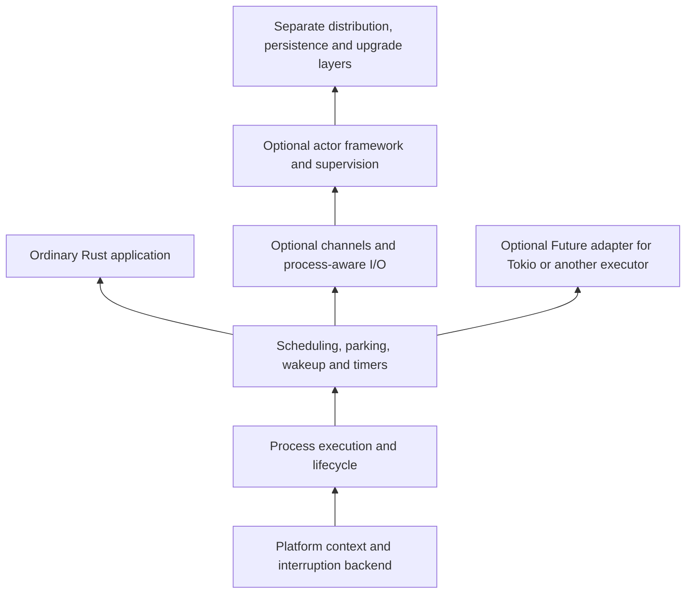

# Native preemptive process library: proposed design

**Status: design proposal, not an implemented or accepted public API.** Accepted requirements include [native runtime-enforced preemption](adr/0001-native-preemptive-processes.md) and [safe forced termination through ordinary Cargo integration](adr/0003-library-build-and-forced-termination.md). The signal experiment shows native scheduling. The generated-process experiment additionally shows termination and cleanup for a closed subset. Safe admission and reclamation for a useful process model remain the architecture's gating obligation; neither experiment establishes a production foundation.

## The smallest useful product

An embeddable runtime owns native execution contexts, runnable queues, automatic preemption, blocking/wakeup transitions, process lifetimes, and a safe termination/cleanup protocol. A program can spawn a CPU-bound computation, collect its result, request forced termination, and inspect whether it is running, runnable, waiting, terminating, or finished. A long-lived process retains owned state and communicates through owned messages using runtime-aware operations.

The runtime's obligation is to regain execution from a CPU hog. Calling a runtime channel's `recv` when there is no message is a normal blocking operation; users must not insert `yield_now` to keep unrelated work alive. Normal CPU computation must resume with registers, stack values, and state intact after every scheduling interruption.

Start with a native library for Linux x86-64 and runtime-aware I/O/synchronization as the **accepted initial profile**, recorded in [ADR 0002](adr/0002-runtime-aware-operations.md). A production port matrix needs separate qualification. The engine and safety model below remain proposals.

## Keep the primitive below actors



This diagram separates responsibilities, not necessarily crates. Avoid a public backend abstraction before one backend's invariants are understood; do not create a multi-crate framework just to look generic.

| Runtime responsibility | Why it belongs here |
|---|---|
| Continuation lifetime | Suspension must preserve a stack/context or generated state machine. |
| Preemption mechanism and exclusion rules | A wrapper outside the running function cannot enforce a turn. |
| Runnable/parked state and wakeup | Channels and I/O must not block an execution worker unnecessarily. |
| Admission and process identity | Prevent unbounded runtime growth and stale handle reuse. |
| Completion and unwinding-panic observation | Applications need a stable process-lifetime contract. |
| Scheduling metadata | Inspection must not depend on a CPU hog volunteering a reply. |
| Channels, timers, mutexes and I/O integration | Needed to use the process abstraction without silently blocking its workers; may live in adjacent modules. |

The accepted first scope is [BEAM/ERTS primitives](adr/0004-beam-primitives-first.md). Supervision restart policies, application-level service registries, distributed discovery, durable storage, Elixir-language compatibility, hot code migration, and operator dashboards belong above this boundary. Basic name-to-process registration is itself a runtime facility in Erlang, although Bream’s first fixture can use direct process identities. A useful standalone example must do ordinary Rust computation with no actor trait or migration protocol.

## Three serious implementation routes

### A. Signal-driven native fibers

Each started process has a fixed stack and home OS worker. A timer/monitor interrupts CPU computation and the backend preserves the context before the scheduler selects another runnable process. A signal request is not sufficient on its own: an endless loop will never inspect a flag unless generated code or context redirection regains control. Native precedents include open-coroutine and desktop rrkernel; their exact implementation and limitations are in the landscape report.

This route most closely matches adding a library dependency with a standard native build. Its central risk is reentrancy. If a fiber is suspended inside an allocator and another fiber on that OS thread enters the allocator, internal state or locks may be reentered in a way ordinary thread safety does not permit. Deferring preemption in runtime-controlled critical sections helps only when all relevant sections are actually covered. A comment saying “don't call unsafe functions” is insufficient: safe Rust code routinely allocates and calls dependencies.

**Proposed constraint:** once started, a native stack stays on its home OS thread. Stealing not-yet-started work is possible; stealing arbitrary suspended work is a separate feature. A `Send` entry closure can create a non-`Send` local after it starts. [corosensei's explicit explanation](https://docs.rs/corosensei/0.3.4/corosensei/struct.Coroutine.html), [standard MutexGuard thread-affinity requirement](https://doc.rust-lang.org/std/sync/struct.MutexGuard.html).

Pinning removes one migration hazard. It does not give fibers their own OS-thread TLS, solve allocator reentrancy, or make a blocking `std::sync::Mutex` into a process-aware mutex. Signals and signal masks also belong to the embedding application; silent global interception is a material compatibility cost.

### B. Automatically generated or instrumented native Rust

A Cargo procedural macro could generate a native state machine with runtime checks on appropriate loop backedges and calls. When a turn expires, generated code saves execution state and returns control; rustc can provide ordinary suspension/drop machinery through generated futures. Application authors write loops with **no manual yields**. This does not inherently require a custom compiler or a separate build step, but the enforceable supported code surface remains an open design question.

This is now the most relevant research route for combining no-manual-yields execution with safe kill, rather than asynchronously unwinding an arbitrary instruction. At a generated boundary the runtime can decline to resume the process and perform supported cleanup. The underlying executor may poll cooperatively; the *process code* must have unavoidable generated checkpoints. Calling a non-returning uninstrumented function would still defeat it, and arbitrary user `Drop` implementations would defeat bounded cleanup.

A custom whole-program compiler pass is a distinct, broader alternative. It would require revisiting the accepted ordinary-Cargo experience and must not be silently conflated with an attribute macro.

The coverage problem is decisive: instrumenting a top-level function with a procedural macro does not instrument an infinite loop in a dependency, inline assembly, or a foreign call. Whole-program claims require a defined transitive compilation boundary and native-call treatment. Checks must survive optimization and be placed where runtime and library invariants allow suspension. An early LLVM pass can have checks optimized or moved; a late pass needs valid register/stack and unwind handling. A scheduling counter alone does not solve this.

Go demonstrates compiler/runtime cooperation, not proof that a Rust procedural macro can recreate it. Rust's documented `llvm_plugins` switch is unstable and marked likely internal rather than intended for general use; it is an investigation hook, not a stable extension contract. [Go preemption implementation](https://go.dev/src/runtime/preempt.go), [Rust compiler flag documentation](https://doc.rust-lang.org/unstable-book/compiler-flags/llvm-plugins.html).

### C. Preserve the interrupted kernel thread

Instead of running another fiber in the interrupted thread's native environment, suspend that kernel thread and hand its logical execution slot to another thread. This preserves the original native stack and TLS association. It is a serious research alternative to unrestricted same-thread signal switching, covered by the PPoPP 2021 prior art in the mechanisms report.

Its cost is the supply of spare kernel threads. If many tasks remain suspended, the scheme can approach one kernel thread per task. Consequently it must report OS-thread count alongside RSS and virtual stacks: it cannot be called a tiny M:N runtime solely because the public API says `spawn`. A bounded spare pool also needs a saturation policy and liveness evidence.

### Decision rule

For scheduling alone, A has already passed the initial mechanism gate. B has now demonstrated generated suspension and ordinary cleanup of a killed infinite process in a closed subset; the [executed probe](../experiments/generated-process/README.md) records its exact limits. For the full accepted product, investigate whether B can grow into a useful checked native process model with owned state and bounded runtime cleanup under ordinary Cargo. A and C do not by themselves solve arbitrary native stack destruction. No engine should be selected until its kill protocol is sound. **If a route fails, do not quietly replace preemption with an explicit-yield API or forced termination with a voluntary stop flag.**

## A concrete state model

```text
Created → Runnable → Running → Completed / Panicked
              ↑          |
              |          ├── quantum expiry → Preempted → Runnable
              |          └── runtime wait → Waiting
              └──────────────────── wakeup ───┘
```

Runtime transitions must prevent double enqueue, resuming one stack simultaneously on two workers, wakeups lost during parking, and freeing a stack still referenced by an interrupt. Pending interruption during scheduler bookkeeping must be deferred and serviced safely. Completion invalidates the incarnation; a recycled slot must carry a generation so stale IDs do not target a new process.

Forced termination adds `KillRequested → ExecutionStopped → Reclaiming → Terminated`. These transitions require an independently proven protocol: the signal probe implements none of them. Publish termination only with the documented execution/cleanup condition satisfied. Already-submitted external effects may require separate completion/reconciliation semantics.

This state machine does not contain automatic restart. A supervisor can subscribe to exits and choose to spawn a new incarnation. Restart is a policy, not a hidden property of a process handle.

## API shape to test, not code that exists

```rust,ignore
let runtime = bream::Runtime::builder().workers(1).build()?;

let a = runtime.spawn(|| expensive_plain_rust_calculation());
let b = runtime.spawn(|| another_plain_rust_calculation());

// Both calculations make progress before either finishes.
let (a_result, b_result) = (a.join()?, b.join()?);
```

An optional join adapter can implement `Future` so Tokio applications can await completion. Process computation executes on Bream-owned workers; invoking a long computation inside an ordinary Tokio `poll` would evade the new runtime's scheduling control. This is coexistence, with explicit ownership of workers and timers, rather than pretending every Tokio task became preemptible.

Before exposing a safe `spawn`, establish the safety contract of every allowed operation inside the closure. `FnOnce + Send + 'static` alone is not the proof. With the kill requirement, the unrestricted closure syntax above may need to become a generated `ProcessProgram` produced by an attribute rather than accepting every native function. This is an unresolved API decision; the snippet must not be interpreted as a supported promise.

## Safe forced termination is a separate required protocol

The signal-based native milestone proves pause/resume and lets finite workloads return naturally. The generated-process milestone additionally stops infinite admitted code and drops its tracked buffer after polling returns. Neither establishes the full first-product contract. Cancellation requests, observed stop, completed runtime cleanup, and process exit are distinct events. A native task may hold a lock or own a resource at interruption; discarding its stack is not an authorized shortcut. Rust's runtime assumptions prohibit arbitrary frame deallocation that skips owned local destructors. [Rust Reference](https://doc.rust-lang.org/reference/behavior-considered-undefined.html#undefinedruntime).

The desired BEAM-style cleanup contract must be achieved through a representation that can safely be reclaimed. Candidate generated code needs approved state/message types, no escaping borrows or hidden child execution, controlled native calls, and cleanup that cannot run unbounded application destructors. A generated Future can be normally dropped at suspension; that provides a safe structural mechanism, but does not alone prove prompt cleanup for arbitrary user types. [Forced-termination research](research/05-forced-termination.md).

An unwinding panic can be caught at a compatible process boundary, subject to panic strategy and unwind safety. `panic=abort`, allocation failure, stack overflow, a segfault, and undefined behavior are not generally isolated from the containing OS process. Native Rust processes must not inherit a BEAM-strength failure-isolation claim merely because they have IDs and mailboxes. [Rust panic-catching contract](https://doc.rust-lang.org/std/panic/fn.catch_unwind.html).

## What “tiny” must measure

Native fixed stacks cannot generally be moved after arbitrary code has taken addresses into them. Small reserved stacks require a depth budget; large guarded reservations consume virtual address space but commit RAM according to page use. Dynamic growth, segmented stacks, and recovery from overflow each need their own implementation proof.

Measure 1/100/1,000/10,000 idle and active processes, then extend only when the earlier sizes succeed. Separate baseline runtime memory, reserved stack address space, touched stack pages, heap state, run-queue/process metadata, mailbox bytes, and native thread count. Use a realistic recursive/allocating workload as well as an empty process. Report spawn/teardown peaks and retention after exit. The lab's Wasm density numbers do not estimate native process costs.

For latency, publish runnable count, worker count, CPU affinity, turn length, timer source, throughput, p50/p99/max observed interruption delay and ready-queue wait. With N runnable processes on one worker and a turn of q, queueing alone can be on the order of `(N - 1) × q`; choosing a 1 ms turn does not imply every process runs every millisecond. OS pauses, nonpreemptible sections and faults add further delay. This is a design estimate, not a hard real-time guarantee.
