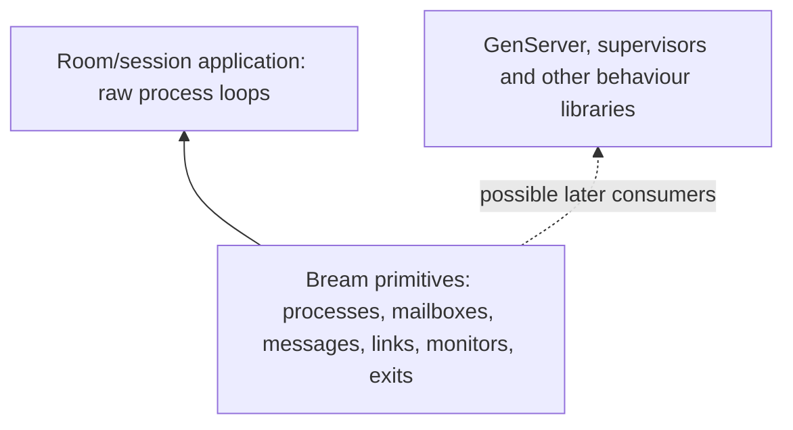

# Bream: BEAM primitive experiments

**Status: scope accepted; implementation checkpoint 2026-10-08.** The user selected Rust APIs, a room/session example, and narrowed the first scope to BEAM process primitives. [ADR 0004](adr/0004-beam-primitives-first.md) supersedes the earlier supervised-service milestone. Restricted [useful-buffer](../experiments/process-milestone/README.md), [structured-state/helper](../experiments/structured-process/README.md), [identity/lifecycle](../experiments/identity-lifecycle/README.md), [mailbox/parking](../experiments/mailbox-process/README.md), [receive-timeout](../experiments/receive-timeout/README.md), [monitor/Down](../experiments/monitor-process/README.md), [links/exit-trapping](../experiments/link-process/README.md), [atomic monitored/linked spawn](../experiments/spawn-process/README.md), [bounded room/session integration](../experiments/room-process/README.md), [immutable payload sharing/broadcast](../experiments/shared-process/README.md), [busy room-member integration](../experiments/busy-session/README.md) and [bounded session replacement](../experiments/session-replacement/README.md) profiles now execute restricted P0–P4 slices. Checked application self-exit and targeted exit are next. Full stages and real-time timer integration remain open; [milestone status](milestones.md) separates passed evidence from upcoming work. The user's [machine constraint](../AGENTS.md) prohibits local speed tests and performance comparisons; timing-based procedures below require another suitable environment and explicit authorization.

The [comprehensive build plan](build-plan.md) is now the detailed work inventory: 40 feature groups, 537 stable branch cases including conditional extensions, implementation dependencies and G0–G7 exit gates. This document retains the P0–P5 experiment rationale. P0 maps to G0/G1; P1 to G2; P2 to G3; P3 to G4; P4 to G5; P5 splits into single-worker measurement G6 and later worker scaling G7. Failure handling, resource accounting and inspection begin with the earliest affected feature, rather than waiting for the final fixture.

The [local BEAM source review](beam-source-map.md) sharpens the pass criteria below. Observable process behavior follows BEAM by default; Rust-specific adaptations remain explicit. Source inspection is not runtime qualification.

The [behavior coverage audit](behavior-coverage.md) confirms that the reference case inventory, Rust mapping and executable conformance evidence are all incomplete. Before a primitive passes qualification, specify its allowed race outcomes and failure classes as well as its successful path; then check those cases against the pinned reference and the Bream implementation. A source link or one passing trace is not an exhaustive specification.

## The boundary

Bream starts with the process model: automatically scheduled processes, process-owned mailboxes, sending and receiving messages, monitoring, linking, and safe lifecycle control. These are the foundation on which application protocols and eventual behaviour libraries can be built.

In Erlang, those facilities belong to the BEAM/ERTS runtime and language semantics. GenServer, supervisor behaviours, restart strategies and application trees are higher-level library abstractions. Erlang/OTP is also the name of the whole distribution, so a feature appearing under an “OTP” documentation heading does not make it an OTP behaviour. [Boundary research](research/10-beam-versus-otp-boundary.md), [runtime process reference](https://www.erlang.org/doc/system/ref_man_processes.html), [OTP design principles](https://www.erlang.org/doc/system/design_principles.html).

The first example will use raw processes. It needs no actor trait, server callbacks, child specification, supervisor, automatic restart policy, or library-level call/cast API.

## Requirements carried forward

Native Rust; ordinary Cargo and standard rustc; Linux x86-64 first; CPU-heavy code suspended and resumed without author-written scheduling yields; safe forced termination and runtime-managed cleanup; process-owned state and owned messages; runtime-aware I/O/synchronization where needed. A generated checked process model is an accepted investigation route; unrestricted Rust compatibility and the production engine remain unselected.

The original probes demonstrate signal-driven native scheduling and generated suspension/cleanup in a closed subset. Twelve implementation milestones now add a checked public boundary, useful owning state/helpers, process identities, a restricted mailbox, receive timeouts driven by injected time, local relationships, an integrated room with two sessions and sealed immutable payload sharing. The application covers owned routing, one failed session, a surviving peer, selective timeout and teardown while an independent computation runs. A separate bounded broadcast now qualifies zero/one/two recipients, surviving-reader ownership and final byte release. A busy room member now computes while the room and peer exchange requests, with direct/linked stop and shutdown ownership checks. One bounded replacement now separates old and current identities and queued work while preserving survivor bytes. General collections, repeated churn, direct exit APIs, real-time timers and runtime-aware I/O remain unimplemented in that profile; the complete public runtime is unqualified. [Current evidence](../README.md), [latest subset](../experiments/session-replacement/README.md).

## Candidate primitive surface

This table describes semantics to investigate, not names or signatures already implemented. The first five rows follow the user’s stated scope; timeout, reference and inspection details are proposed support for testing them.

| Primitive family | What it provides | What it does not imply |
|---|---|---|
| Process execution | Spawn, current process identity, independent progress, suspended state and lifetime | Actor behaviour, automatic restart, or host-crash isolation |
| Mailbox and messages | One process owns its mailbox; send transfers a message; receive consumes selected messages | Handler callbacks, shared mutable application state, or acknowledgment that work was performed |
| Monitoring | One-way death observation, monitor identity, demonitor, atomic monitored spawn | Failure propagation or supervision policy |
| Linking | Bidirectional exit relationship, unlink, atomic linked spawn; explicit exit-trapping rules | Parent/child ownership, a supervision tree, or unconditional death on every exit reason |
| Exit and termination | Normal/explicit exit reasons, forced kill, truthful execution-stop and cleanup observations | Running arbitrary application destructors or reversing external effects |
| Receive timeout and references | Waiting without occupying a worker; correlate application messages and deadlines | GenServer.call or a generalized RPC framework |
| Runtime inspection | Identity, execution state, mailbox count/bytes, scheduling progress, resource accounting and exit reason | Observer GUI or an arbitrary application-state debugger |

Selective receive is the accepted BEAM-reference behavior: find the earliest matching message while retaining unmatched messages. Its Rust syntax depends on the message-type decision below. Matching guards and mailbox scanning must participate in the execution guarantee. Signal processing for kill, links and monitors must not depend on application code reaching its next `receive`.

Basic local name registration, timers and aliases are also runtime facilities in Erlang. They are not reclassified as OTP behaviours merely because the first Bream slice can use direct process identities and a small receive-timeout facility. Add each only when a concrete primitive test needs it.

## Recorded choices and current frontier

- **Q11 answered:** idiomatic Rust with familiar process concepts. The user explicitly corrected the initial boundary to BEAM primitives, excluding GenServer and supervisors.
- **Q12 answered:** room/session reference workload, implemented with raw processes.
- **Q13 answered:** typed Rust protocols, with process identity/link/monitor operations independent of payload type.
- **Q14 answered:** BEAM-style growing mailboxes; ordinary local send does not wait for receiver consumption or a capacity slot. Queue growth is measured; unlimited host memory is not promised. [ADR 0005](adr/0005-typed-growing-mailboxes.md).
- **Q15 answered:** selective receive retaining unmatched messages, with an optional timeout. Matching scans must remain automatically schedulable.
- **Q16 answered:** BEAM-style normal/abnormal exit rules and exit trapping, with untrappable direct kill. [ADR 0006](adr/0006-beam-exits-and-trapping.md).
- **Q18 answered:** one runtime envelope combines typed payloads and application-visible lifecycle notifications in the same selective mailbox. [ADR 0007](adr/0007-unified-runtime-envelope.md).
- **Q19 answered:** runtime-managed immutable byte storage may be shared through owned references. [ADR 0008](adr/0008-immutable-buffer-sharing.md).
- **Q20 answered:** `Down` follows execution stop and removal of the live identity; tracked reclamation completion is separately observable. [ADR 0009](adr/0009-death-and-reclamation-observation.md).
- **Q21 answered:** follow BEAM observable semantics by default, including silent discard on send to a dead process. [ADR 0010](adr/0010-beam-observable-semantics-by-default.md).

The receive matcher API must preserve the accepted typed protocol and runtime envelope. Native allocation failure behavior still needs a concrete primitive specification; growing mailboxes do not turn send into an application-delivery acknowledgment. Exact exit/trapping traces must be derived from the selected BEAM rules and checked against reference fixtures. Q22–Q23 remain open on helper/host-job scope and the representative CPU work. Rust syntax, supported state/helper operations and experimental latency targets are outputs of the first design/qualification work; the plan does not claim those mechanisms work already.

## Experiment order

| ID | Experiment | Dependencies | Decisive evidence |
|---|---|---|---|
| P0 | Useful checked process code and public admission | Q13; room/session sketch | Useful owned state and helper work compile; safe API cannot admit arbitrary uninstrumented code |
| P1 | Process identity, automatic turns and forced death | P0 | An infinite process repeatedly resumes, peers progress, and kill stops/reclaims it without application cooperation |
| P2 | Mailbox, send, selective receive and wakeups | P0/P1; Q13/Q14 | Correct ownership/order, no lost wakeup, unmatched messages retained, scans remain schedulable |
| P3 | Monitors, links and exit signals | P1/P2 | Race-safe lifecycle observations and tested exit/trapping matrix, independent of user receive |
| P4 | Raw room/session integration | P0–P3 | Sessions communicate and observe death while an unrelated process hogs CPU; no behaviour framework |
| P5 | Density, fairness and worker scaling | Correct P4 fixture | Measured costs and latencies with equivalent state, plus qualified cross-worker races |

Runtime metadata starts with P1 and grows with each primitive. It is part of making the experiments observable, not a later operator-dashboard project.

### P0 — a useful process body and an enforceable boundary

Write a small Rust process-loop sketch and a corresponding Elixir program using raw `spawn`, `send`, `receive`, `Process.monitor` and `Process.link`. Neither version imports GenServer or Supervisor. Label each Rust operation as already admitted, proposed checked code, or runtime-owned work; sketches are not claimed to compile.

The minimum proposed useful surface is owned structs/enums, identifiers and payload bytes, ordinary matching, a small collection of session addresses, and approved helper calls with CPU work. The payload/state proposal must implement the accepted typed protocol. The present probe only admits primitive locals and an opaque buffer, so this is a significant new qualification gate.

For each admitted helper, operator, guard and collection operation, identify its maximum indivisible work, saved partial state and cleanup obligations. BEAM's trapping list operations demonstrate that these are separately engineered runtime responsibilities. The checked caller cannot interrupt an opaque callee. Immutable-buffer construction, sharing and final release also need qualification; admitting the type does not establish those operations' costs.

Build the public boundary in a separate consuming crate. Try to bypass it with an arbitrary future/closure, forged program marker, raw identifiers, reexports, nested macros, arbitrary callbacks/trait operators, custom destructors, scoped threads and uninstrumented dependencies. Public runtime helpers needed by generated code must not accidentally confer process guarantees on ordinary code.

**Pass:** the useful program is expressible without handwritten scheduling checks; unsafe or unsupported execution/cleanup paths cannot enter through ordinary safe construction. Retain compile diagnostics and the ownership/admission argument. If the admitted surface is too awkward or cannot be enforced, revise it before adding messaging features.

### P1 — raw execution, identity and termination

Introduce process handles with distinct lifetimes and stale-handle protection. Exercise completion, explicit exit and forced kill. Test that dropping an ordinary process address does not itself terminate the process, and that explicit runtime shutdown safely stops live admitted processes without freeing continuations that can still resume; the exact host shutdown API is still to design. Give a CPU hog owned state, and make a peer compute a checked result on one worker. Measure automatic suspension/resumption, then request kill independently of the hog’s application mailbox.

Extend checkpoint coverage to admitted helpers and data operations. Compare a small range of renewable work budgets against the existing one-suspension-per-loop-iteration probe. No authored yields or stop polling are allowed. Keep kill acceptance, execution stopped, owned cleanup completed and observation distinct in the trace, even if a final API later combines some events.

**Pass:** peers progress; the hog resumes correctly before being killed; no execution occurs after its stop acknowledgment; tracked state is reclaimed exactly once. Slot reuse alone must not retarget an old address. Eventual full-ID reuse follows an explicit identity contract, while internal stale references always need valid lifetime protection; see LIFE-01.C07/C08 in the [lifecycle build plan](build-plan/lifecycle.md). A watchdog killing the test executable is failure containment, never a successful process kill.

### P2 — mailbox ownership and receive semantics

Give each process its own mailbox. Test send, waiting receive, receive timeout and selective matching with ordinary messages and explicit correlation identifiers. A request and reply are application messages here; there is no framework-level call/cast abstraction.

Instrument ownership transitions before publication, while queued, during match selection and after consumption. Kill the sender or receiver at each boundary. Ordinary send to a dead process discards the payload through approved cleanup and does not report recipient handling or admission. Test death with queued/unmatched messages, timeout racing a matching arrival, cancellation of a wait, and concurrent wakeups. If a checked-send extension is ever added, give it a separate precise contract; it is not required by this first BEAM-compatible path.

Check per-sender ordering in the chosen ordinary local mode. A match consumes only the selected message; unmatched messages retain relative order. A backlog of nonmatches must not monopolize the worker: both scanning and approved guards need bounded segments or generated scheduling boundaries. Arbitrary uninstrumented predicate callbacks are outside the proposal.

Keep the scan cursor across turns and nonmatching wakeups within one pending receive; reset it for the next receive after selection or timeout. Test that timeout is not repeatedly rearmed by unmatched arrivals, and that `after 0` still scans eligible messages. Preserve BEAM's scan/wait timing rather than silently substituting a host deadline that starts before the initial scan. Model the empty-scan/wait-registration/publication handshake explicitly so no interleaving sleeps forever with matching work already queued. Typed messages, `Down` and trapped `Exit` retain one selection order while internal control remains independent of application consumption.

Teardown is work too: kill a process with a large queued backlog and verify that reclaiming its mailbox does not monopolize the worker. Trace execution stop and incremental resource reclamation separately; fast logical death must not conceal retained unaccounted payloads.

**Pass:** no lost wakeup, double drop, retained orphan payload or unintended message reordering. Kill and lifecycle control remain serviceable under queue pressure. The chosen capacity policy is visible in the API and measured; it cannot silently alter BEAM-style send expectations.

### P3 — monitoring and linking, without supervision

Test atomic monitored/linked spawn with a child that exits immediately. Cover monitoring an already-dead target, multiple monitor tokens, demonitor racing death, link/unlink racing exit, and stale identities after process-slot reuse. Distinguish cancellation of future notifications from removal of a death message already queued; any flush option needs its own race trace. A monitor records death; a link participates in exit propagation. Neither creates a restart policy.

Follow BEAM's explicit-flush behavior: ordinary demonitor does not remove an already-materialized `Down`. Test unlink followed by relink with a delayed acknowledgment from the old unlink; it must not remove the new active relationship. Port the observable local exit cases, including distinctions between direct kill, linked reasons and self-exit APIs, instead of simplifying them from their names.

Use a reference matrix for normal exit, explicit failure, requested shutdown and forced kill, with linked/unlinked and trapping/non-trapping receivers. Distinguish direct untrappable kill from a reason propagated along a link. Validate runtime signal handling while the target is computing, waiting, or scanning its mailbox; it must not require an application stop message.

`Down` must follow irreversible application execution stop and removal of the live identity, with required visible-resource invalidation specified alongside each admitted resource. Final tracked reclamation may follow and must have a separate completion observation. This deliberately excludes BEAM's dirty-NIF exception: admitted Bream application work cannot keep running after `Down`. Cleanup releases the dead process's references; live recipients may still retain shared immutable bytes.

**Pass:** no missed initial death, stale retargeting or unintended failure propagation; traces match the selected local BEAM cases or an explicitly documented Rust difference. No supervisor, restart factory, child spec, initialization behaviour or GenServer callback is needed to pass.

### P4 — room/session fixture from raw processes

The proposed in-memory topology has a room process owning membership state, several session processes, and an independent computation process used to saturate a worker. The host supplies initial process addresses directly. Networking, a service registry and durable state are unnecessary for this first fixture.

Use ordinary protocol messages for joining, leaving, publishing a payload and querying membership. Sessions and the room monitor relevant lifetimes so the application can remove dead members or report a room exit. Test a deliberately linked pair separately to demonstrate link propagation; links should not accidentally turn every participant into one failure group.

Exercise the accepted immutable-buffer model during fanout: kill the publisher and some receivers while other receivers still read the payload. Account physical buffer storage separately from per-process references, and verify exactly-once final release. Membership scans and fanout must themselves participate in scheduling.

Run one session or the independent computation into an infinite admitted loop. Other processes must remain responsive, the host must be able to inspect and kill the hog, and its monitors must observe the expected result. The busy process is not expected to handle its own next application message before it finishes the current computation.

**Pass:** the primitive API expresses the example without runtime-internal access or actor-framework glue. Message/resource accounting balances after process death. The fixture does not automatically restart anything. Manually spawning a fresh process may test identity reuse, but is not a supervision feature.

### P5 — measure and then extend

Measure empty waiting processes and realistic room/session processes separately at 1, 100, 1,000 and 10,000 processes as capacity permits. Report shared baseline, RSS/PSS slope, virtual memory, logical owned state/mailbox bytes, native thread count, spawn/exit costs, throughput, ready-queue delay, receive-scan work, and kill-to-stop/stop-to-cleanup latency distributions. The current 72/64-byte future values are not full process costs.

Use the same raw-process protocol and comparable state on a pinned Erlang/Elixir reference. An async Rust baseline can show cost tradeoffs without being described as meeting Bream’s CPU-hog contract. Record hardware, optimization and worker count; a measured maximum is not a hard deadline.

Add workers only after the single-worker lifecycle holds. Stress send/kill, monitor/death, wakeups and completion across workers with declared ownership/state-transition invariants. Generated representation and Rust transfer rules determine migration eligibility.

**Pass:** a documented useful operating range, reproducible traces and honest cost/latency tradeoffs. Performance targets follow initial measurements and the chosen workload; they are not invented in this plan.

## What the comparisons now contribute

- **BEAM/ERTS:** direct reference for primitive process, mailbox, signal and lifetime semantics.
- **Gleam’s raw process API:** typed addresses and lifecycle operations. Its OTP actor wrapper’s unmatched-message policy is not a substitute for raw selective receive.
- **Pony:** enforced ownership and immutable-sharing ideas, with a different scheduling contract.
- **Beamlet:** lessons from process/resource lifetime boundaries and kill tests; its Wasm execution and supervisor API do not define Bream’s native surface.
- **Go/Ergo and Rust actors:** useful negative controls showing how a familiar API can lack forced termination of a non-returning callback/poll.

Sources: [BEAM versus OTP boundary](research/10-beam-versus-otp-boundary.md), [runtime and OTP semantics review](research/07-beam-otp-experience.md), [Beamlet/Go audit](research/08-beamlet-and-go.md), [typed-process review](research/09-typed-process-experience.md). Earlier recommendations for an OTP-style supervised-service milestone are superseded by the accepted primitives-first scope. Comparator sources were reviewed; comparator executables have not been run.

## Outside the first milestone

GenServer/GenStateMachine behaviours, supervisor trees, restart policies, OTP application lifecycle, generic call/cast framework, process pooling and actor traits are higher-level library work. They are not dependencies or hidden acceptance gates for the primitive milestone.

Socket I/O, aliases, broader timer APIs, name registration and multi-worker optimization can follow demonstrated primitive needs; these are runtime extensions, not automatically OTP-only features. Distribution, code upgrade, shared ETS-like tables, durability and graphical tooling are separate later investigations. Their deferral does not diminish the accepted automatic scheduling and safe forced-termination requirements.

## Evidence and decisions

Every executable experiment must retain source/compiler/dependency identity, build flags, artifact hashes, raw traces and a bounded external watchdog. Prefer explicit events/barriers and trace models over lucky sleeps in race tests. Resource counters measure logical reclamation separately from allocator RSS retention.

Scope, workload, typed messages, growing mailboxes, selective receive/timeouts and BEAM-style exit/trapping semantics are settled. The next action proposed for the future experiment phase is P0: a raw room/session Rust sketch beside its Elixir primitive reference, followed by a separate consuming-crate test of the required checked language surface.

The concrete P0 deliverables are: protocol/state sketches; a table of required approved data operations and helper calls; examples rejected by the public boundary; and a short feasibility review explaining what can be implemented safely next. P0 does not include a GenServer wrapper, supervisor, networking, distribution or performance promise. Its outcome determines whether P1/P2 can proceed or the generated model must be revised.

**Source-review checkpoint:** the user reopened the interview and requested a deeper local BEAM source review instead of finalizing at Q17. The experiment sequence remains a proposal to refine against implementation evidence. No production API has been selected and none of P0–P5 has been run.

## Reference execution update

[Report29](research/29-pinned-reference-observations.md) now supplies selected G0 reference observations from an exact pinned core build, including release/debug and optimized/unoptimized controls. It also records a reproducible debug assertion. These results resolve several earlier predictions for their tested setups; they do not complete G0, select the production engine or qualify Rust admission. The public Rust boundary and bounded ownership/interleaving models remain the next implementation investigations.

## Protocol model update

[Reports 30–33](process-runtime-inventory.md) deepen buffer retirement, parking/timer wakeup and relationship cancellation. Two finite interleaving abstractions have now run, with five broken controls detecting lifetime/heap misuse and lost wakeups. Broader products and an actual implementation remain unqualified. The [build plan's next protocol experiments](build-plan.md#next-protocol-experiments) names the controlled pause points, including an unresolved late-buffer-installation candidate; it does not convert that source concern into an upstream defect claim.

## Performance-source follow-up

[Reports 34–37](process-runtime-inventory.md) expand message preparation, balancing, timer and generated-execution branches. The [36-task performance backlog](performance-plan.md) supplies a shared workload catalogue and baseline/treatment comparisons, including room/session fanout, CPU interference, timer bursts and death storms. The 31 added cases bring the catalogue to 423; all features and optimization tasks remain planned. G1 admission and termination are still decisive, with multi-worker and general-timer work conditional on their later gates. No new runtime benchmark was run.

## Rust ownership and representation follow-up

The [Rust opportunity map](rust-opportunities.md) and reports 38–41 deepen collector roots, table/spawn publication, allocator ownership and the limits of Rust admission bounds. That pass brought the catalogue to 447 cases and the performance backlog to 54 tasks. New language evidence comprises 24 compiler invocations and 12 executions from 12 fixtures, with all expected observations, including counterexamples to destructor-dependent cleanup and broad Send/Sync admission. These are neither speed tests nor Bream process qualification. Prior benchmark, reference and finite-model evidence is unchanged.

PERF-052/054 sharpen the useful public admission experiment; PERF-053 supplies a borrowed-state qualification path. Then compare typed live state and owned message transfer before adopting region, slab or multi-worker policies. Clear reference semantics remain settled; implementation proof obligations are research work, not user preference questions.

## I/O and observation ownership follow-up

Reports 42–45 extend the catalogue to 474 cases and 70 performance tasks. Linux polling, snapshot/trace-session teardown and native-resource callbacks now have finer branch obligations; five isolated Linux scenarios ran in both compiler profiles with expected observations. That pass added optimization targets including typed notification construction, stable registration storage, bounded snapshot abandonment and resource cleanup, and explicit observer/callback ownership.

The order remains useful admission, single-worker scheduling/kill, messages, relationships and the room/session fixture. I/O follows that slice with an explicit owner-death-to-safe-close experiment, followed by PERF-055–060. Broad snapshots/tracing and generic native resources are conditional extensions; they must not inflate the first milestone into BEAM or NIF API compatibility. Reuse their lifetime findings for minimal runtime diagnostics and approved handles. [Current plan](build-plan.md), [opportunities](rust-opportunities.md), [Linux evidence and limits](research/45-linux-io-observations-and-rust-boundary.md).

## Concurrency and clock qualification follow-up

Reports 46–49 extend the catalogue to 500 cases and 85 performance tasks. Typed runtime access should distinguish retained metadata, protected fields and application execution authority; no internal guard may silently survive a declared quiescent point. Typed clock/deadline values and checked rounding belong with receive timeout work. A stopped set of managed workers does not establish that all host/native readers have left.

Three small Loom baselines complete and four deliberate weakenings expose publication, final-owner visibility or wakeup failures. Use them to sharpen actual protocol models after choosing the minimal correct initial implementation. They do not choose that implementation. Domain partitioning, coordinator cadence and lock-contention tuning follow qualified host/multiworker concurrency; changing clock correction applies only to provider paths that require it. Admission, single-worker scheduling/kill and the room/session sequence remain the first product gates.

## System tasks, code lifetime and typed routing follow-up

Reports 50–53 extend the catalogue to 523 cases and 99 performance tasks. System work now distinguishes admission, execution, coalescing and per-request settlement; literal retirement distinguishes code removal, evacuation and final freeing; name routing distinguishes operation-time resolution from captured identity. Eight local reference families completed in three pinned profiles, with 300 race rounds. Two Rust variance controls ran in two optimization profiles with expected acceptance/rejection outcomes.

Early Rust candidates include private typed task records, bounded completion cursors and genuinely static immutable payloads. Names/caches and dynamic data retirement remain conditional extensions. The next research frontier is recorded in the [source inventory](process-runtime-inventory.md#latest-checkpoint-and-next-source-frontier); useful admission and safe stop remain the first production gates. No benchmark or production implementation was added.

## Responsiveness-first evidence follow-up

Q24 selects predictable peer and safe-stop responsiveness before throughput, without a numeric deadline. Reports 54–57 bring the inventory to 537 cases and 107 tasks. The user subsequently ordered all speed-test evidence removed and redone. Notification correctness models and optimization sources remain; no speed conclusion or backend selection remains qualified.

Next useful work combines admitted useful process code with fixed offered timestamps, peer-ready/kill endpoints and runtime service, while resolving source-specific completion-order and teardown hypotheses. Raw ownership-loop speed and an API notification count are insufficient acceptance evidence under Q24.
